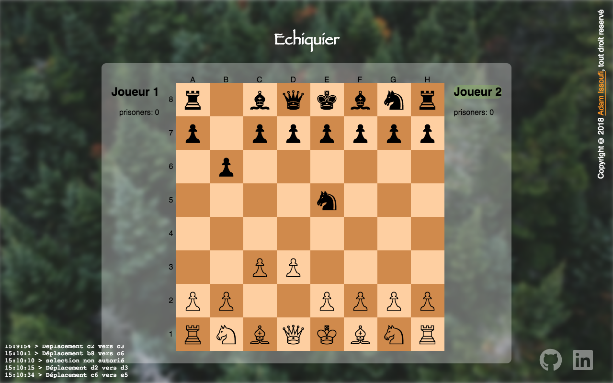

# Chess

A chess game for two players in the browser, written in vanilla JavaScript, with the full rules:
castling, en passant, promotion, check, checkmate and stalemate.

**Live demo:** https://AIssoufi.github.io/chess

<p align="center">
  
</p>

## Tech stack

| Tool                           | Role                                 |
| ------------------------------ | ------------------------------------ |
| JavaScript (ES modules)        | Game model and UI, no framework      |
| Vite 5                         | Dev server and production build      |
| Vitest 2                       | Unit tests of the game model         |
| Prettier 3                     | Code formatting                      |
| Husky, lint-staged, commitlint | Git hooks: formatting, commit format |
| pnpm 12, Node.js 24            | Package manager and runtime          |

## Getting started

Prerequisites:

- Node.js 24 or newer (`.nvmrc`);
- pnpm 12.14.0, pinned by the `packageManager` field of `package.json`.

```bash
pnpm install    # install the dependencies and the Git hooks
pnpm start      # dev server on http://localhost:5173/chess/
pnpm build      # production build in dist/
pnpm preview    # serve dist/ on http://localhost:4173/chess/
```

## Scripts

| Script              | Purpose                                     |
| ------------------- | ------------------------------------------- |
| `pnpm start`        | Start the Vite dev server with hot reload   |
| `pnpm build`        | Build the site into `dist/`                 |
| `pnpm preview`      | Serve the production build                  |
| `pnpm test`         | Run the unit tests once                     |
| `pnpm format`       | Format every file with Prettier             |
| `pnpm format:check` | Check the formatting without changing files |

## Tests

`pnpm test` runs Vitest in Node.js, without a DOM. The tests live in `test/` and are named
`*.test.js`.

## Project structure

```text
app/                 Vite root: the page, its styles and images
  css/               Styles and images
  js/                Game code
    Echiquier.js     Board model and rules, without DOM
    main.js          UI controller: renders the board and handles clicks
    pieces/          Piece configs: Unicode symbol and starting squares
redirect/            Page that redirects the old GitHub Pages URL to the new domain
test/                Unit tests
.github/workflows/   CI and deployment
```

## CI and deployment

- **CI** (`ci.yml`): on every pull request and push to `master`, installs with the frozen lockfile,
  then runs `pnpm format:check`, `pnpm test` and `pnpm build`.
- **Deploy** (`deploy.yml`): on every push to `master`, builds the site and publishes `dist/` to
  GitHub Pages. The Vite `base` is `/chess/` to match the Pages URL.

## Conventions

- Commits follow [Conventional Commits](https://www.conventionalcommits.org/), checked by
  commitlint on each commit.
- Prettier formats the staged files on each commit, and the CI rejects unformatted files.
- pnpm only runs the build scripts of the packages listed in `allowBuilds` of
  `pnpm-workspace.yaml`.

## License

[MIT](LICENSE)
