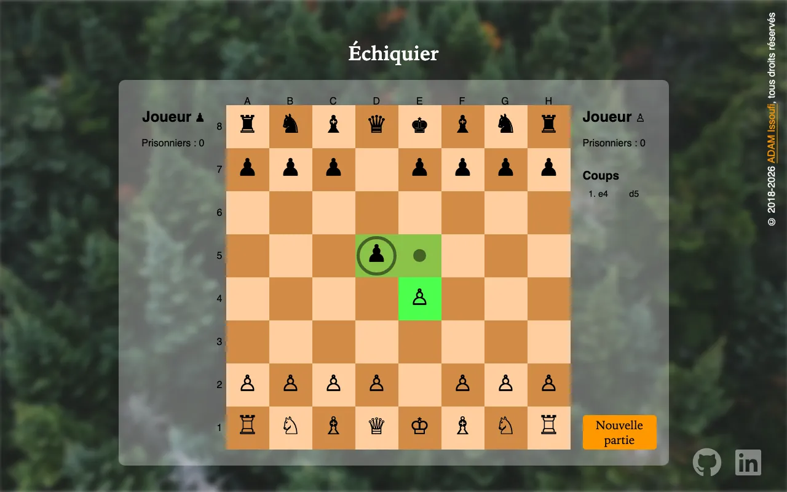

# Chess

A chess game for two players in the browser, written in vanilla JavaScript, with castling, en
passant, promotion, check, checkmate, stalemate and the draw rules (insufficient material, fifty
moves, threefold repetition). The moves of the game show in a list, in French algebraic notation.

**Live demo:** https://chess.issoufi.fr

<p align="center">
  
</p>

## Tech stack

| Tool                           | Role                                               |
| ------------------------------ | -------------------------------------------------- |
| JavaScript (ES modules)        | Game model and UI, no framework                    |
| Vite 8                         | Dev server and production build                    |
| Vitest 5, happy-dom 21         | Unit tests, with a DOM for the UI                  |
| Playwright 1.64                | Browser tests in Chromium and WebKit, on the build |
| Prettier 3                     | Code formatting                                    |
| ESLint 10                      | Linting, with the recommended rules                |
| Husky, lint-staged, commitlint | Git hooks: formatting, linting, commit format      |
| pnpm 12, Node.js 24 and 26     | Package manager and runtime                        |
| Cloudflare Pages               | Hosting, with a preview per branch                 |

## Getting started

Prerequisites:

- Node.js 24 (`.nvmrc`), or 26 and newer: Vitest 5 does not support Node.js 25;
- pnpm 12.14.0, pinned by the `packageManager` field of `package.json`.

```bash
pnpm install    # install the dependencies and the Git hooks
pnpm start      # dev server on http://localhost:5173/
pnpm build      # production build in dist/
pnpm preview    # serve dist/ on http://localhost:4173/
```

## Scripts

| Script               | Purpose                                     |
| -------------------- | ------------------------------------------- |
| `pnpm start`         | Start the Vite dev server with hot reload   |
| `pnpm build`         | Build the site into `dist/`                 |
| `pnpm preview`       | Serve the production build                  |
| `pnpm test`          | Run the unit tests once                     |
| `pnpm test:coverage` | Run the tests once with a coverage report   |
| `pnpm test:e2e`      | Build, then run the browser tests           |
| `pnpm format`        | Format every file with Prettier             |
| `pnpm format:check`  | Check the formatting without changing files |
| `pnpm lint`          | Lint every JavaScript file with ESLint      |

## Tests

`pnpm test` runs Vitest. The tests live in `test/` and are named `*.test.js`:

- the tests that need no DOM run in Node.js:
  - `chessboard.test.js`, `fen.test.js` and `perft.test.js`: the board model and its rules, the
    FEN loader of the tests, and the move counts of reference positions;
  - `board-navigation.test.js`, `castling.test.js`, `colors.test.js`, `draws.test.js`,
    `game-over.test.js`, `labels.test.js`, `moves.test.js`, `notation.test.js`,
    `squares.test.js` and `status.test.js`: the helpers of the game modules of `app/js/`;
  - `accessibility-style.test.js`: the reduced motion and the square focus of the stylesheet;
  - `not-found-page.test.js`: the French 404 page, parsed with happy-dom's `DOMParser`;
  - `redirect.test.js`: the page that redirects the old GitHub Pages URL;
  - `public-files.test.js`: the build copy of the root files, `robots.txt`, the sitemap and the
    HSTS header;
  - `commitlint.test.js`: the ticket reference rule, the bot commits and the pull
    request titles of commitlint;
  - `e2e-helpers.test.js`: the helpers of the browser tests;
- the tests that need a DOM run in happy-dom, chosen by a `// @vitest-environment happy-dom`
  comment on their first line:
  - `index-page.test.js`: the head of the page and its social preview image;
  - `accessibility-page.test.js`: the landmarks, the board, the move list and the screen reader
    names;
  - `french-punctuation.test.js`: the French punctuation of the shown texts;
  - `copyright.test.js`: the footer year;
  - `main.test.js`: the UI controller;
  - `piece-factory.test.js`: the piece factory;
  - `rendering.test.js`: the pieces, square labels, status, captures, check and move list;
  - `selection.test.js`: the selected square, its moves and what a click does;
  - `roving-focus.test.js`: the keyboard focus of the board;
  - `promotion.test.js`: the promotion choice;
  - `alerts.test.js`: the game over dialog;
- `prepare-commit-msg.test.js` runs Git in temporary repositories to test the hook that adds the
  ticket trailer.

`pnpm test:coverage` adds a V8 coverage report of `app/js/`: a summary in the terminal and an
HTML report in `coverage/`, which Git and Prettier ignore.

### Browser tests

`pnpm test:e2e` runs Playwright on the production build, in Chromium and WebKit. It builds the
site, serves `dist/` with `vite preview` on a free port, and runs the `*.spec.js` files of `e2e/`.
Each page gets the Content Security Policy of `app/public/_headers`, which `vite preview` does not
send, and a test fails on any console error, a blocked script or style included.
[ADR 0007](docs/decisions/0007-test-in-a-browser-with-playwright.md) lists what they check.
`scrollbars.spec.js` runs in Chromium only, launched with the classic scrollbars of a desktop
window, which take room from the page where overlay ones take none.

Install the two browsers once, and again after an upgrade of `@playwright/test`:

```bash
pnpm exec playwright install chromium webkit
pnpm test:e2e
```

A test that fails on an open layout issue is marked `test.fixme`, with the issue number in its
title, and shows as skipped until that issue is fixed. A failure writes its error context to
`test-results/`, which Git and Prettier ignore.

## Project structure

```text
.husky/              Git hooks: lint-staged, the ticket trailer and commitlint
app/                 Vite root: the page, its styles and images
  css/               Styles and images
  js/                Game code
    alerts/          Game over dialog: writes the winner or the draw reason, shows and hides it
    board-navigation/ Keyboard navigation of the board: the key moves and the roving focus
    castling/        Castling helpers, such as whether a rook may castle with its king
    Chessboard.js    Board model and rules, without DOM
    colors/          Color helpers, such as the opponent of a color
    copyright/       Writes the current year at the end of the footer copyright
    draws/           Draw reasons and their labels, insufficient material and the position key
    game-over/       Move outcome (check, mate, stalemate, draw) and its alert
    labels/          Screen reader names of the pieces and the squares, in French
    main.js          Wiring: listens to the board, the promotion and the dialog, calls the modules
    moves/           Piece steps, special move names and labels, and the capture helper
    notation/        French algebraic notation of a move, its rival pieces and the turns of the list
    PieceFactory.js  Creates the DOM node of a piece from its type and color
    pieces/          Piece configs: Unicode symbol and starting squares
    promotion/       Promotion choice: shows the pieces of the pawn color and reads the click
    rendering/       Renders the pieces, square labels, status, captures, check and the move list
    selection/       Selected square, its moves and their highlight, and what a click does
    squares/         Board size and square helpers, such as the square an en passant capture takes
    status/          Status announcement: the last move, whose turn it is and the game outcome
  public/            Files copied as they are to dist/: the Cloudflare Pages _headers, the
                     404 page and its stylesheet, the favicon, the 1200x630 social preview
                     image (og-image.jpg), robots.txt and the sitemap
commitlint/          Ticket reference rule, bot commits and the pull request title config
docs/                README screenshot, decisions (ADRs), the evolution of the stack and
                     ai-workflow/ (how agents work on the project)
e2e/                 Browser tests (Playwright): the layout, scrollbar and game specs, and helpers
playwright.config.js Playwright config: the browsers, and the preview server on a free port
redirect/            Page that redirects the old GitHub Pages URL to the new domain
test/                Unit tests
.github/workflows/   CI, commit message checks, actionlint, the live check and the GitHub Pages
                     redirect
```

## CI and deployment

- **CI** (`ci.yml`): on every pull request and push to `master`, runs four jobs; `check`,
  `test (node 26)` and `e2e` install with the frozen lockfile first:
  - `check`: `pnpm audit --audit-level high` (which fails on an advisory of high or critical
    severity), `pnpm format:check`, `pnpm lint`, `pnpm test` and `pnpm build`, on the Node.js
    version of `.nvmrc` (24);
  - `test (node 26)`: `pnpm test` again on Node.js 26;
  - `playwright-version`: reads the exact `@playwright/test` version of the lockfile;
  - `e2e`: `pnpm test:e2e` in the official Playwright image of that version, which ships the
    browsers and their system libraries. A bump of the package moves the image with it, and the
    job fails while no image exists for the new version.
- **Commit messages** (`commit-messages.yml`): on every pull request, and when its title changes,
  runs commitlint on each commit that the base branch lacks, and on the title with
  `commitlint/pr-title.config.js`, which needs no ticket reference.
- **Actionlint** (`actionlint.yml`): on every pull request that changes a file of
  `.github/workflows/`, lints the workflows, and the scripts of their `run` steps with shellcheck,
  using the official actionlint binary checked against its SHA-256.
- **Cloudflare Pages** deploys the game from its Git integration: `master` to
  https://chess.issoufi.fr, and every other branch to a preview URL, linked from its pull request.
  The build is served from the root of the domain, so Vite keeps its default `base` of `/`. An
  unknown path answers 404 with `app/public/404.html`, a French page that links back to the game;
  `pnpm preview` serves the game page there instead.
- **GitHub Pages redirect** (`deploy.yml`): on a push to `master` that changes `redirect/` or the
  workflow, or when run by hand, publishes `redirect/` to the old URL,
  https://aissoufi.github.io/chess/, with a copy of its `index.html` as `404.html`. The page sends
  every URL below `/chess/` to the same path, query and fragment on https://chess.issoufi.fr, and
  falls back to the home page without JavaScript.
- **Live check** (`live-check.yml`): every hour on https://chess.issoufi.fr, or by hand on any
  host, checks that the site serves its home page, the scripts and styles it links, the social
  preview image and the favicon, and that the old GitHub Pages URL still redirects to it. GitHub
  emails a failed scheduled run to the last person who changed its `cron` line. GitHub pauses
  the schedule after 60 days without repository activity; re-enable it from the Actions tab.
- **Dependabot** (`.github/dependabot.yml`): each week, one pull request bumps the GitHub Actions,
  one bumps the npm packages within their major, and each new major of a package gets its own.
  Their commits and titles start with `ci(deps):`, `build(deps):` or `build(deps-dev):` and a
  capitalized `Bump`, which the commit and title checks let through; other capitalized subjects
  still fail.

### Cloudflare Pages settings

The Pages project and its custom domain are set up in the Cloudflare dashboard, not in this
repository:

| Setting                | Value                                                     |
| ---------------------- | --------------------------------------------------------- |
| Production branch      | `master`                                                  |
| Preview branches       | All non-production branches                               |
| Framework preset       | None                                                      |
| Build command          | `pnpm build`                                              |
| Build output directory | `dist`                                                    |
| Root directory         | Empty, the repository root                                |
| Build system version   | 3                                                         |
| Node.js version        | Read from `.nvmrc` (24)                                   |
| Environment variables  | `PNPM_VERSION=12.14.0`, the version of `packageManager`   |
| Custom domain          | `chess.issoufi.fr`, a CNAME to the project's `.pages.dev` |

`app/public/_headers` sets the response headers: a one-year immutable cache for the hashed files
of `/assets/`, and a Content Security Policy, a Permissions Policy and HSTS on every page. The
policy only allows the scripts, styles, images and requests of the site itself, never inline code:
a page must hold no `<style>`, `style` attribute, inline script or event handler attribute. Pages
already sends `X-Content-Type-Options` and `Referrer-Policy`. Change `frame-ancestors` in that file
to embed the game in another site. HSTS lasts one year and covers this host only, without
`includeSubDomains` or `preload`, since this repository does not serve the parent `issoufi.fr`.

## Conventions

- Commits follow [Conventional Commits](https://www.conventionalcommits.org/) and name their
  ticket in a `Refs: CHESS-<n>` trailer, which the `prepare-commit-msg` hook adds on a `CHESS-<n>`
  branch. commitlint checks each commit locally and in CI, merge, revert, fixup and bot commits
  aside, and the CI checks each pull request title like a commit header, without the ticket.
- Prettier formats the staged files on each commit, and the CI rejects unformatted files.
- ESLint (`eslint.config.js`) applies its recommended rules, with browser globals for `app/` and
  `redirect/` and Node.js globals for the configs and the tests. It fixes what it can in the
  staged JavaScript files on each commit, before Prettier, and the CI rejects any finding.
- pnpm runs no build script of a dependency unless the package is listed in `allowBuilds` of a
  `pnpm-workspace.yaml`. No dependency needs one, so the repository has no such file.

## Documentation

[docs/ai-workflow/](docs/ai-workflow/overview.md) explains how Claude Code agents maintain this
repository, from an issue to a deployment.

## History

[docs/evolution.md](docs/evolution.md) traces the tools and the architecture since 2018.

## License

[MIT](LICENSE)
